# RushB v0.10.6 独立 UI 最终复审

审阅日期：2026-10-25。

本报告由独立审阅代理依据模拟器截图形成。没有阅读应用源代码、实施方修订分析或实现说明，没有操作模拟器，没有修改应用文件。初始报告 [UI-INDEPENDENT-v0106-initial.md](UI-INDEPENDENT-v0106-initial.md) 保持原样。

最终证据为 `docs/screenshots/review-v0106/after/` 中的 01–18、21、22、24、25，共 22 张截图，均已使用 `view_image` 逐张查看。六张 `before/` 基线在复审过程中重新查看并与对应新版核对；过程中的队标与统计表问题还核对了 `process/03-matches.png`、`process/08-statistics.png` 和 `process/18-ct-statistics.png`。本报告按最终 `after/` 状态下结论，过程图仅用于说明已修复问题。

## 总体结论

浅色改版的视觉结果可以认可：页面背景与卡片更中性，灰色队标底板去除后主要队标更清楚；设置页统一为“名称、当前值、进入箭头”，筛选选中态有明确勾选和填充；排名卡片从全周区域色描边改为侧边标识，队名与积分重新成为视觉重点；战队资料和统计布局更紧凑。

复审途中发现的两项问题已在最终截图解决：赛事页黄色 Vitality 队标改为适合浅底的黑色变体；比赛统计表增加了稳定列宽、对齐和分隔，ADR、KAST、Swing 与 Rating 不再黏连。深色排名的已展示队标也有可辨轮廓。

本轮没有发现可由截图证实的 P0 级任务阻断。仍保留一项 P1 数据解释问题、一项 P2 阅读体验问题，以及低优先级的入口语义和局部赛事标识问题。因此，这是一份有保留项的视觉复审结论，不代表所有产品、数据或交互问题已经清零。

优先级沿用初始报告：P1 影响关键选择或数据理解；P2 影响阅读、布局或一致性；P3 为局部可发现性、措辞或资产适配问题。截图无法支持的功能判断单列在后文。

## 初始问题及过程发现的复核结果

| 编号 | 原问题 | 最终判断 | 截图证据 |
| --- | --- | --- | --- |
| F1 / P1 | 筛选已选项与未选项太接近 | **视觉修复，可关闭。** 已选项有深蓝填充、白色勾选和粗体，未选项为白底中性边线。默认及非默认条件均能直接辨认。 | [原图 04](screenshots/review-v0106/before/04-filter.png)、最终 04、14 |
| F2 / P1 | 战队页胜率、冠军、球员 Rating 缺少统计范围 | **保留。** 最终 06 仍只显示“胜率 61.1%”“冠军 2”和无版本的“Rating”。比赛统计 08/18 的 Rating 3.0 标签是改善，但属于不同页面，不能据此补全战队统计含义。 | [原图 06](screenshots/review-v0106/before/06-team.png)、最终 06、08、18 |
| F3 / P2 | 同一比赛状态采用不同位置和样式 | **视觉修复，可关闭。** 03 中所见比赛统一按时间、BO3、状态排列，“待更新”不再一部分放顶部徽标、一部分放底部文字。更新时间仍是独立次级信息。 | [原图 03](screenshots/review-v0106/before/03-matches.png)、最终 03 |
| F4 / P2 | 排名全卡区域色描边抢占层级 | **视觉修复，可关闭。** 最终使用中性边线与窄侧边色条，区域仍有文字和圆点，队名、名次与积分更突出。 | [原图 05](screenshots/review-v0106/before/05-ranking.png)、最终 05、15、17 |
| F5 / P2 | 战队资料区和三项统计占高、留有大块空区 | **视觉修复，可关闭。** 队徽、名称、地区、关注收进紧凑顶行，排名与教练并排，三项统计处于同一行。相同视口能看到更多球员内容，没有靠缩小主要文字解决。 | [原图 06](screenshots/review-v0106/before/06-team.png)、最终 06 |
| F6 / P2 | 悬浮导航遮行，末项是否可达不明 | **所拍末端遮挡疑虑排除，保留中途阅读问题。** 15 的排名 #253、16 的折叠末组、24 中末组展开后的最后两场，以及 25 的最后赛事卡均完整位于导航上方。03、05、07、17 的中途状态仍有导航遮行和导航下方露出内容片段。 | 最终 03、05、07、15、16、17、24、25 |
| F7 / P3 | 纸张状图标目的不明，排名变化“0”语义弱 | **保留。** 最终截图未显示图标文字说明，排名不变仍显示“0”。长按提示或辅助功能名称是否存在，无法由截图判断。 | 最终 02、03、05、07、17 |
| R1 / P2，过程发现 | 去除灰底后，黄色 Vitality 队标在浅底上偏淡 | **视觉修复，可关闭已展示样本。** 最终 03 的 Vitality、Spirit 和 9z 在浅底上轮廓明确；05 的对应队标清楚；17 深色页采用可辨识的浅色/描边版本。 | [过程 03](screenshots/review-v0106/process/03-matches.png)、最终 03、05、17 |
| R2 / P1，补图发现 | 统计表头与数值列黏连 | **当前视口视觉修复，可关闭。** 最终 08/18 的表头和数据列一一对齐，有间隔和分隔线；18 首行的 ADR 100.5、KAST 75.8%、Swing +1.73%、Rating 1.38 能分别辨认。 | [过程 08](screenshots/review-v0106/process/08-statistics.png)、[过程 18](screenshots/review-v0106/process/18-ct-statistics.png)、最终 08、18 |

## 保留的问题与可落地建议

| 优先级 | 问题及证据 | 建议与验收标准 |
| --- | --- | --- |
| **P1 — F2** | **战队统计口径仍不清楚。** 图 06 中的胜率没有周期/场次范围，冠军没有统计范围，球员 Rating 没有版本或周期。用户能读出数值，却不能判断它代表近期、赛季还是其他范围。这里没有判断数值错误。 | 在真实数据支持的情况下增加周期、样本数和指标版本；如源数据未提供，明确显示“统计范围未注明”或提供可发现的说明入口。不得猜测填入“生涯”“近三个月”等口径。验收时，用户应能从当前页或明确说明入口理解每项数值覆盖范围。 |
| **P2 — F6** | **悬浮导航中途覆盖造成阅读分割。** 03/05/07/17 中，内容同时出现在导航上方与下方，部分队伍/赛事行中间被遮。15/16/24/25 已证明排名、折叠及展开赛事末组、赛程的所拍末端都能完整露出，不能再把“末项必然不可见”当成已知缺陷。 | 可给悬浮导航增加延伸到底部安全区的承托背景或渐隐，明确可读内容的截止位置，同时保留已有末端留白。验收关注静止状态下是否还有难以对应的半行从导航下方露出。末项点击、收藏等实际动作仍不在本审阅的验证范围内。 |
| **P3 — F7a** | **纸张状顶栏入口含义不明确。** 02/03/05/07 的同一图标仅凭外观无法确定用途。 | 优先增加短标签，或确认有可发现的提示及准确的无障碍名称。应让首次使用者能判断入口目的；当前截图没有证明该入口失效。 |
| **P3 — F7b** | **排名变化“0”缺少语义说明。** 05/17 的名次下方有“0”，上下变化有箭头，持平状态却需要自行推断。 | 可改成“持平”或短横线，并在榜单说明中注明变化比较口径。若保留“0”，至少让辅助功能朗读为“排名无变化”。 |
| **P3 — R3** | **个别赛事标识仍需浅底适配。** 图 16/24 的 NODWIN Clutch Series 13 标识以白色为主，在浅灰分组头上较淡；图 03/25 的 PGL 小标识内部细节也不易辨认。对应赛事名称都清楚，因此是局部资产可读性问题，非任务阻断。 | 对这些具体资产提供适合浅底的版本，或仅为不适配资产提供轻量对比底。保持其他已清楚的队标现状。验收为图形轮廓可辨，不要求在小尺寸下读出标识内所有微小文字。 |

## 逐图记录与最终证据

以下编号沿用文件名。它们是审阅证据序号，不代表审阅者亲自完成了这一串操作。

### 01 外观 — 健康，布局改善

主题、底部导航、启动页面均采用一致的设置行，当前值和进入箭头对齐。相较原版将选项横向铺开的卡片，设置层级更明确。较多空白来自设置项少，无需填充额外内容。

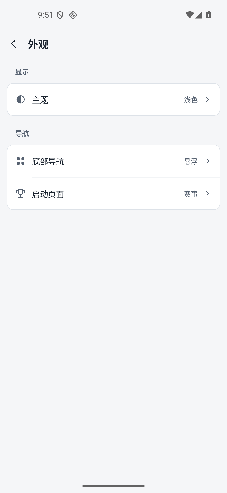

### 02 我的 — 基本健康，保留图标语义项

白色卡片与中性背景的层级稳定，设置行边线更轻，正文与当前值清楚；底部导航没有遮住本屏主要设置内容。顶栏纸张状入口仍需说明，见 F7a。

### 03 赛事 — 状态与队标改善，保留中途覆盖

日期、比赛状态筛选、赛事分组、时间和对阵的层级清楚。“待更新”位置统一。Vitality 已改为黑色变体，Spirit、9z 及其他已展示队标不再依赖灰色方块。悬浮导航下方仍露出后续队伍片段，见 F6。

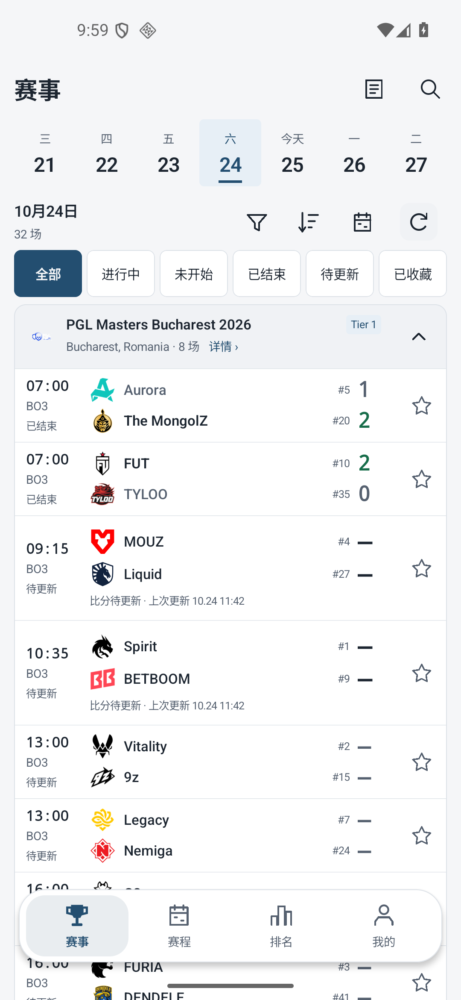

### 04 默认筛选 — 健康，已选态明确

“不限地区”“全部级别”通过勾选、深色填充和粗体表示选择；其他项的白底使可选状态更明确。关闭、重置和“显示 32 场”都完整可见。

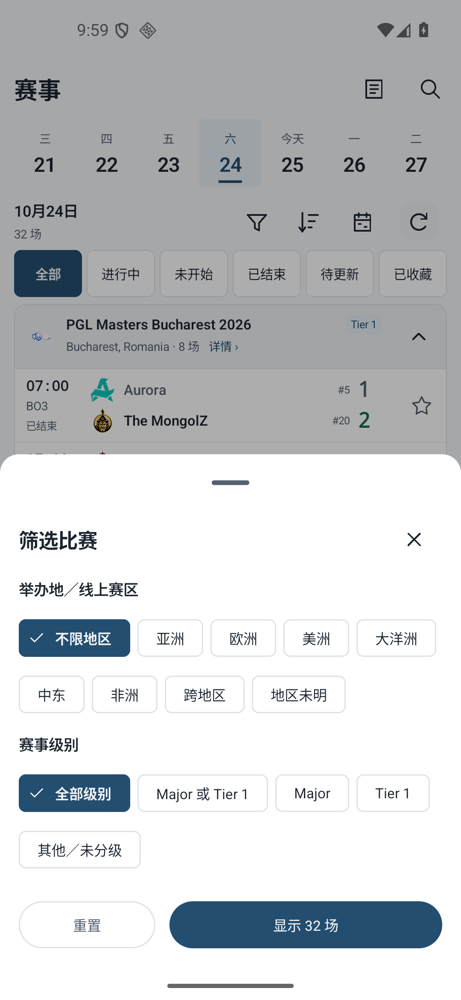

### 05 排名 — 主要层级改善，保留中途覆盖和持平语义

队徽、队名、名次、积分形成稳定列。区域色仅保留于窄侧边及标签，不再环绕整卡。所拍浅色队标清楚；“0”的解释和导航遮行分别见 F7b、F6。

### 06 战队 — 布局改善，数据解释保留 P1

身份区、排名/教练和三项统计更紧凑，五人阵容姓名没有截断；同屏能展示更多球员。关注按钮可见但仍属于低强调动作，这没有构成新的截图缺陷。胜率、冠军和球员 Rating 的范围说明仍不足，见 F2。

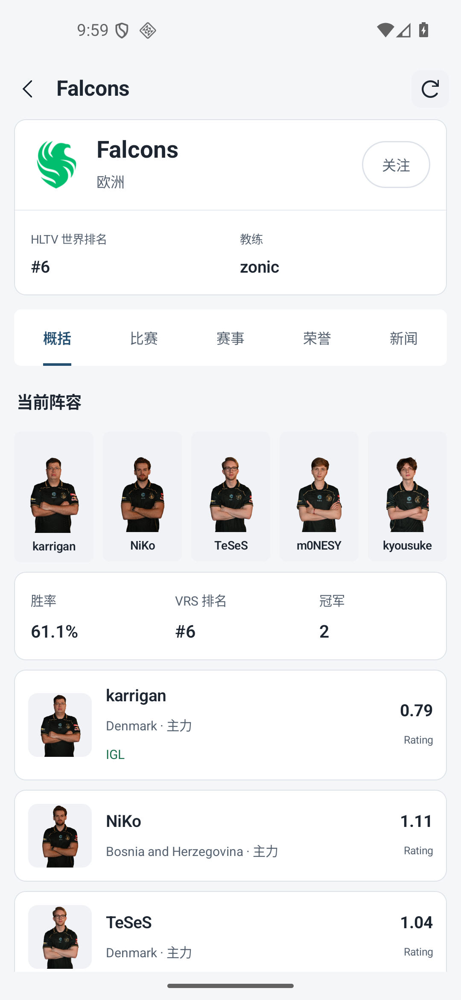

### 07 赛程 — 月历健康，列表入口受中途覆盖影响

月份、日期网格、跨周赛事条和当前日期清楚。重点/全部/关注战队筛选与列表搜索层级可辨；搜索框下缘和赛事卡被悬浮导航覆盖，属于 F6 的同类表现。没有证据判断日期点击或月份切换是否正确。

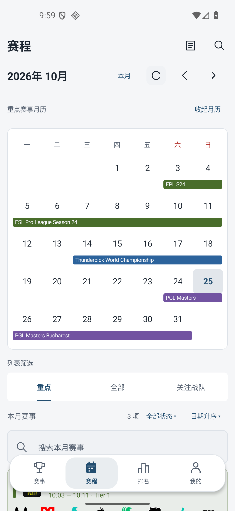

### 08 比赛统计 — 当前视口通过列可读性复核

地图 BP、各图比分、阵营筛选和球队表格分区清楚。表头与数据使用一致列边界，过程图中“SwingRating 3.0”和数值连读的问题已消除。Rating 3.0、全部地图、全阵营提供了该比赛视图的解释。此结果只覆盖所拍字号和数值长度。

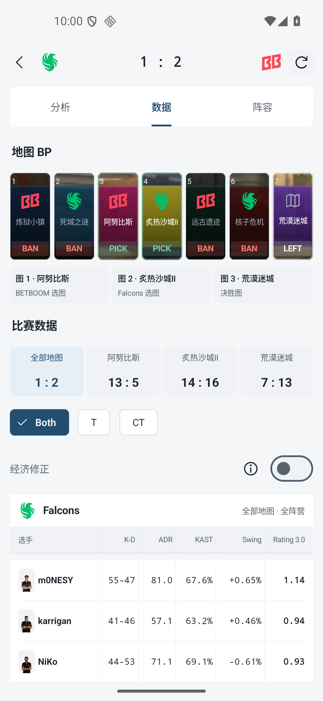

### 09 主题面板 — 健康

深色、浅色、跟随系统完整可见。选中的浅色通过单选圆点、粗体和整行高亮表达，没有仅靠颜色区分；标题与关闭入口明确。

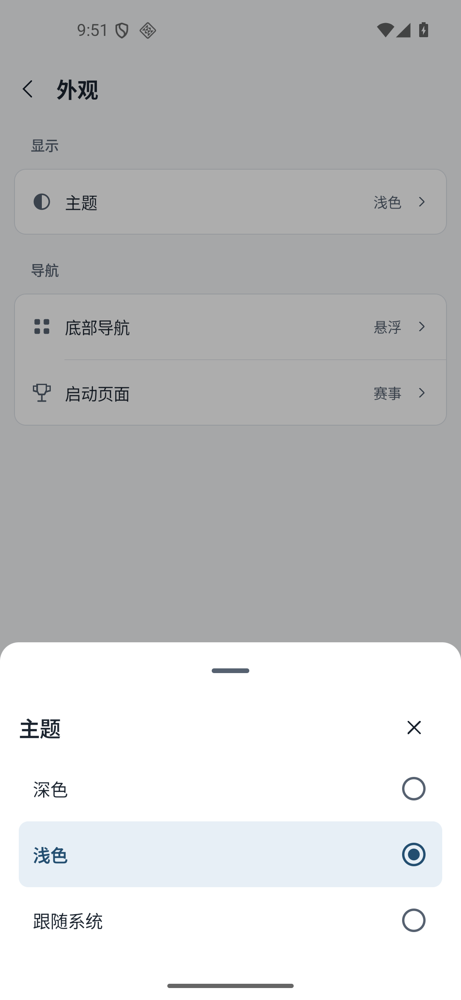

### 10 底部导航面板 — 健康

固定、悬浮两项使用与主题相同的单选结构，当前悬浮状态清楚。截图不能证明点击后的生效时机，但静态选择模型明确。

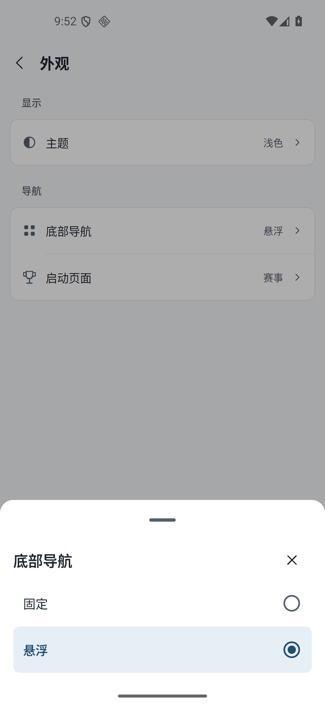

### 11 固定导航 — 当前页面健康

导航贴底并与内容区形成清楚边界，四个入口及选中状态完整可见。本屏是“我的”页，不能把其无覆盖结论扩展为所有长列表都通过验证。

### 12 启动页面面板 — 健康

四个启动页面选项完整显示，当前赛事有单选圆点及高亮。列表式设置及底部面板的表达一致，没有发现裁切。

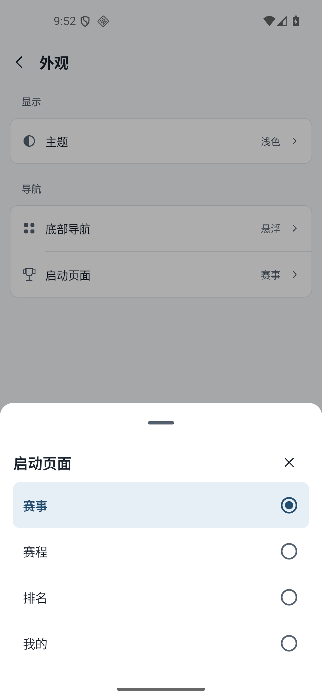

### 13 排名显示状态 — 页面呈现正常，启动行为未由截图证实

排名页面正常显示且导航选中排名。单张截图无法判断它是否由冷启动进入，也无法证明选择在重启后持久保存。

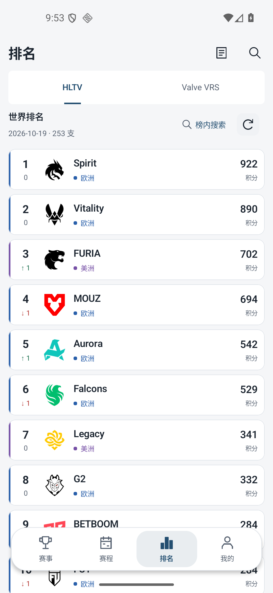

### 14 非默认筛选 — 健康

欧洲、Tier 1 的勾选与深色填充清楚，“显示 8 场”完整可读，未选项没有被挤出或截断。只确认可见选择和显示计数，未独立核验计数与底层数据是否一致。

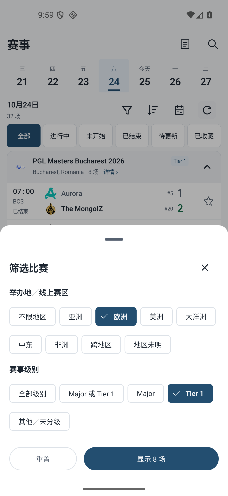

### 15 排名末项 — 当前末端可见性通过

第 253 名 WAZABI 的整张卡片、区域、变化与积分均在悬浮导航上方完整显示，且有间隔。因此，不能再将该榜单当前末项被导航遮住作为缺陷。实际点击、其他字号与设备尺寸仍未操作验证。

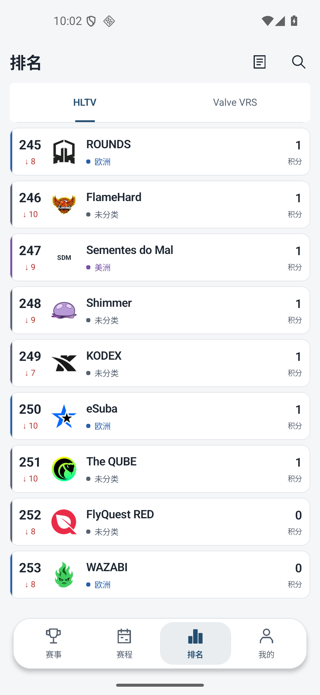

### 16 赛事末项 — 当前折叠末组可见性通过，局部标识偏淡

最后一个 Circuit X Curitiba Season 4 分组完整位于导航上方，详情和展开箭头均可见。此图为折叠态；展开后的最后一场另由补图 24 验证显示。NODWIN 的白色赛事标识偏淡，见 R3。

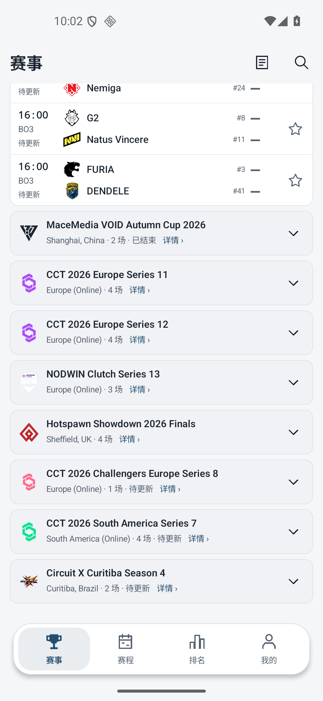

### 17 深色排名 — 已展示队标与正文可辨

Spirit、Vitality 使用浅色轮廓，FURIA 有清楚描边，G2 等图形也能从暗底中辨认；正文与主要数据清楚。区域标签依然同时有文字和颜色。中途浮动导航覆盖仍存在。该图仅覆盖排名中的这一组资产，不代表全库队标均已验证。

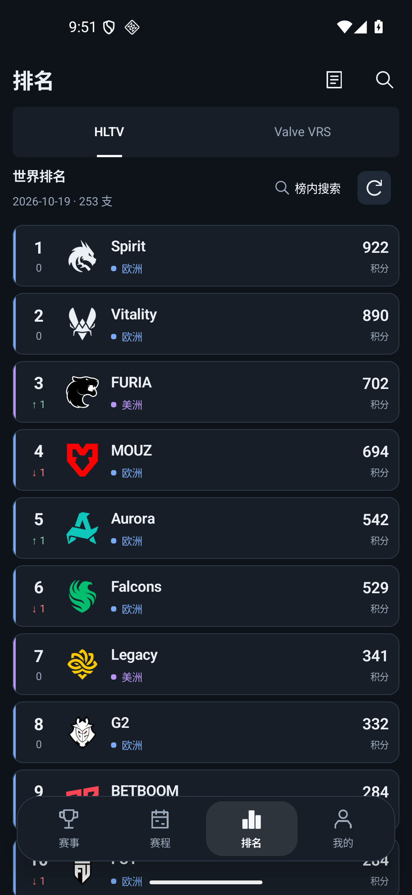

### 18 CT 统计 — 当前视口通过列可读性复核

CT 的勾选、深色填充及表格右上“全部地图 · CT 阵营”互相对应。首行长数值 ADR 100.5 与相邻 KAST 75.8% 有明确列边界，Swing 和 Rating 也能分别读取，过程中的列黏连问题在该样本中已解决。

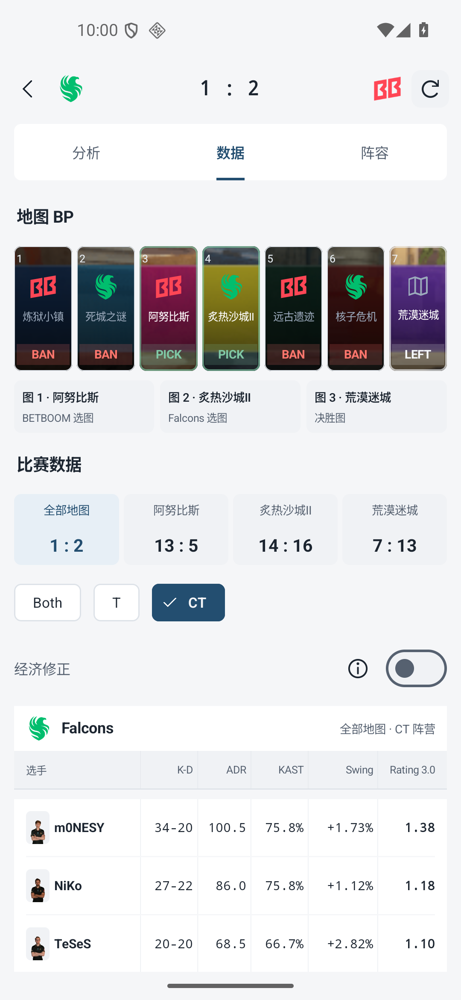

### 21 跟随系统的深色外观 — 呈现健康

主题当前值为“跟随系统”，界面呈现完整深色，文字、图标、边线与分组可辨。此图证明一个被捕获的深色状态，不能证明自动切换的触发过程或时机。

### 22 跟随系统的浅色外观 — 呈现健康

相同“跟随系统”设置下，界面呈现完整浅色，设置层级、当前值和箭头保持一致。与 21 合看，可以确认这两个被捕获状态都正常，不能据静态截图扩展为生命周期、持久化或无闪烁验证。

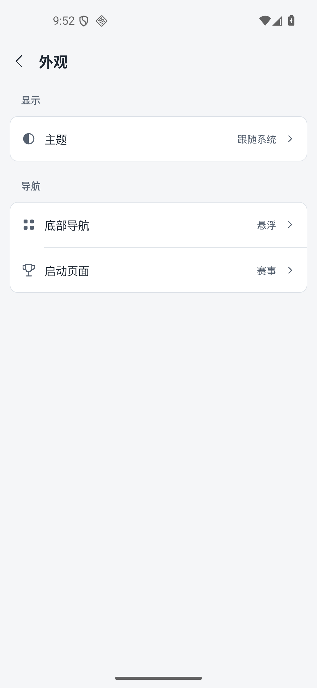

### 24 赛事末组展开 — 所拍最后两场完整可见

Circuit X Curitiba Season 4 已展开。Galorys/paiN 与 BESTIA/Imperial 两场的队名、时间、状态、比分占位和收藏星标都完整位于悬浮导航上方，底部还有间隔。补充证据排除了图 16 单独无法回答的“展开末组是否遮住最后一场”这一视觉疑虑；没有独立点击这些动作。

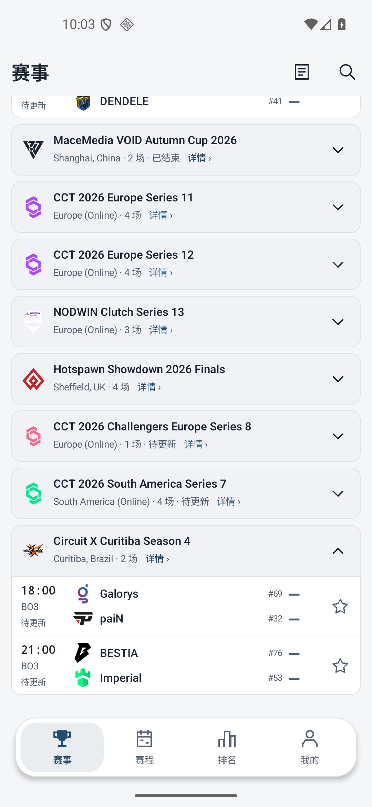

### 25 赛程末项 — 所拍三项赛事完整可见

ESL Pro League、Thunderpick、PGL 三张赛事卡完整显示，最后一张卡及其两行队标全部位于导航上方。赛事颜色与月历条保持对应，标题和日期清楚，更多浅色队标样本可辨。PGL 小赛事标识仍是 R3 的局部资产尾项。

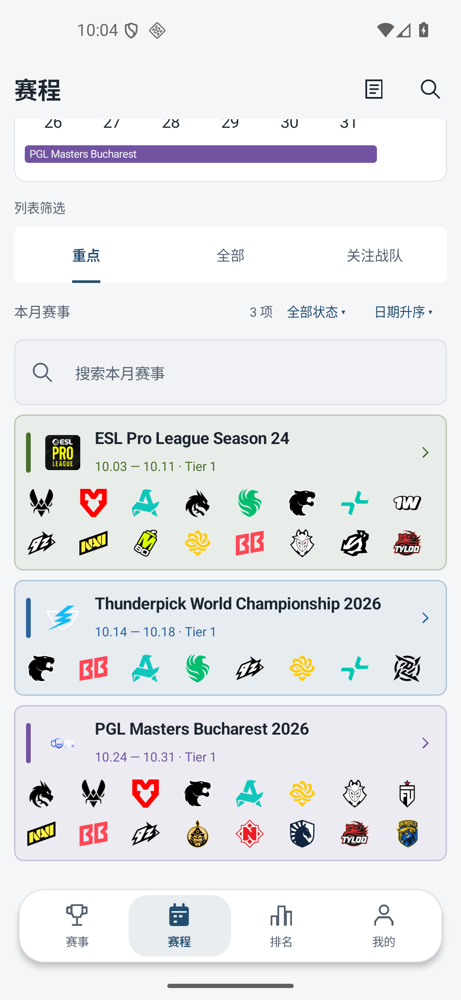

## 证据边界与未验证风险

1. **本审阅限定截图。** 没有点击、滚动、重启、切换系统主题或操作网络；主代理的实际操作记录应作为独立证据，不混入本报告的亲自验证范围。
2. **末端显示与可操作不同。** 15、16、24、25 排除了所拍排名末项、折叠和展开赛事末组、赛程末项的视觉遮挡；未验证点击命中区域和收藏动作，也未覆盖全部固定导航长列表、字号与设备尺寸。
3. **设置与筛选提交模型未验证。** 09/10/12/14 显示选择状态清楚；取消、关闭、系统返回、重置、应用、持久化，以及筛选计数是否正确，都不能由这些截图确定。
4. **主题验证仅限所示状态和资产。** 17、21、22 的画面正常，不代表所有页面、图片来源、队标和加载回退都完成了浅深色验证。
5. **统计表仅验证当前尺寸。** 08/18 已解决本轮所示列黏连；更长姓名、更长数值、较窄屏幕和大字号仍需实际检查。不能把本轮结论表述为所有响应式和字体缩放场景均通过。
6. **无障碍合规未认证。** 已观察到选中态有勾选/单选圆点、状态不完全依赖色相；没有读取无障碍树，也没有测量触控范围、对比比值或测试 TalkBack，不能宣称 WCAG 合规或不合规。
7. **异常与动态状态未覆盖。** 无网络、刷新失败、空数据、图片失败、加载占位、动画、焦点和跨页返回行为不在当前证据中。
8. **数据真实性未审计。** 未核对 HLTV 原始数据、数据抓取或统计计算。F2 指出的是可见说明不足，不是对数值正确性的否定。

当前无需为了完成这份截图审阅继续等待页面。建议后续先补足 F2 的真实统计说明，再决定是否调整 F6 的内容边界；其余保留项可作为小范围完善。

