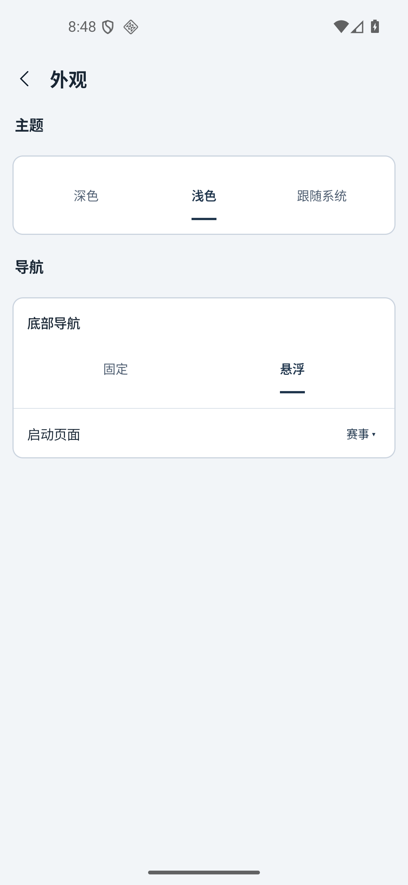
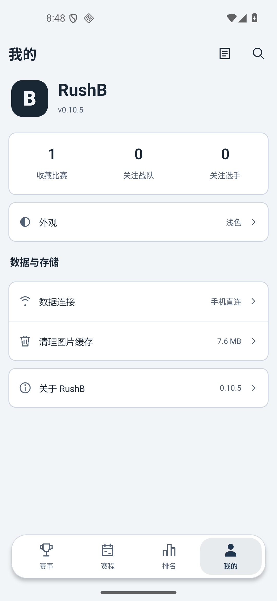
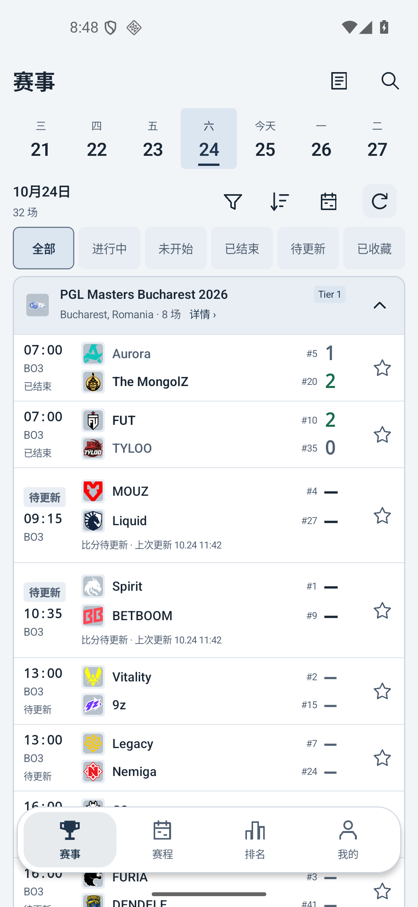
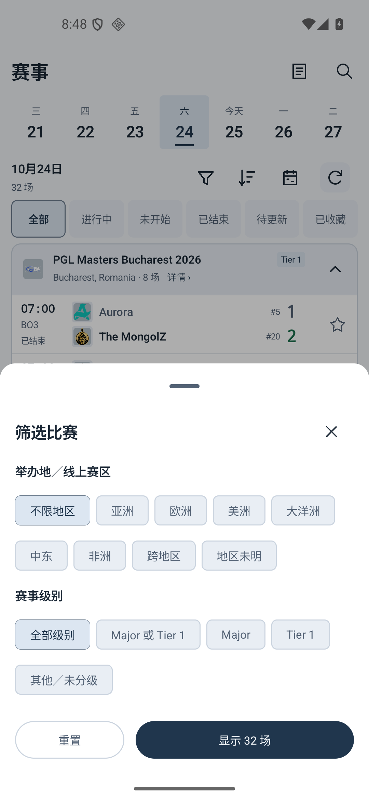
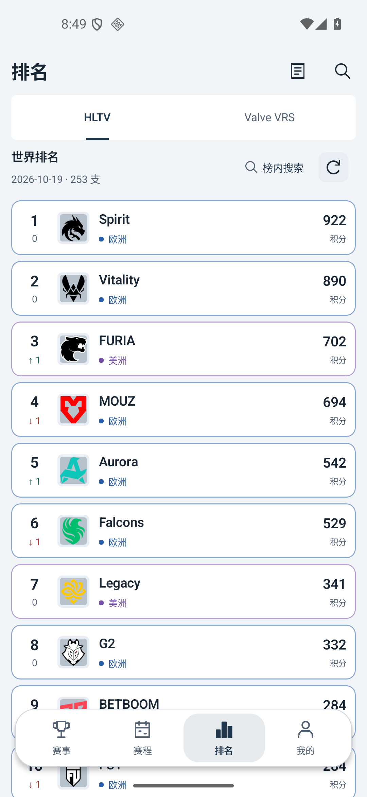
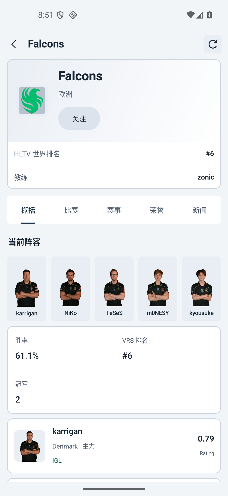

# RushB v0.10.6 第一轮独立 UI 审阅

审阅日期：2026-10-25。证据为主代理提供的本轮模拟器实际截图，目录为 `docs/screenshots/review-v0106/before/`。逐张使用 `view_image` 查看了六张原图；没有阅读应用源代码、实施方分析或历史审阅报告，没有修改应用文件，也没有操作模拟器。

本报告只评估截图所示的浅色界面。截图序号是本次审阅顺序，不代表已亲自完成这些页面之间的操作流程。不能据此确认交互、无障碍语义、数据准确性或完整的浅色/深色适配。

## 总体结论

整体结构可用：深色正文在浅底上清晰，页面标题、赛事分组、比赛对阵与比分能够快速辨认；底部导航有图标和文字，筛选面板有明确的重置、关闭与结果数量按钮。六张图中没有发现可证实的任务阻断、主要文字截断或元素相互错位。

本轮最高优先级是提升选择状态的明确性、统一比赛状态表达，以及补足数据指标的解释。随后再收敛排名卡片描边和战队页空间分配。无需通过重新设计整套界面来解决这些问题。

优先级说明：P1 为可能使用户误解关键选择或关键数据、应优先修正的问题；P2 为阅读、布局和一致性问题；P3 为较小的可发现性或措辞问题。没有发现 P0 级阻断问题。以下条目描述的是截图可见现象；推测性的操作风险另列。

## 按优先级排列的修改建议

| 编号 | 优先级 | 截图可见证据与影响 | 可落地修改 | 复审验收标准 |
| --- | --- | --- | --- | --- |
| F1 | P1 | 图 04 的“不限地区”“全部级别”与其他筛选项均使用接近的浅灰蓝底、灰蓝描边。选中与未选中主要依靠细微色差及边线区别，快速扫视时确认当前条件的成本偏高；未选项的整体灰化也容易看成不可用。 | 已选项增加勾选符号，并使用明显不同的文字粗细/填充；未选项使用更轻的中性底或白底。保留当前标签和分组，不需要改动整个面板。 | 不依赖细微色相，也能直接说出两个分组当前选中的项；已选、可选、禁用三种状态（若有禁用）不会混淆。 |
| F2 | P1 | 图 06 显示“胜率 61.1%”“冠军 2”，没有可见的统计周期或样本范围；球员的“0.79 Rating”也没有可见的指标版本/时间范围。数值本身可读，但用户不能从此屏判断这些数值意味着什么。 | 给胜率补充真实的周期/场次口径，冠军说明统计范围；Rating 的版本和周期使用短副标题或可发现的信息入口。只能显示实际已有的元数据；若未知，应直接标注未注明，不能猜测。 | 用户从页面文字或明确的说明入口能辨别数据覆盖范围；不能把“近期”“生涯”等未经确认的口径添加进去。 |
| F3 | P2 | 图 03 同属“待更新”的比赛采用两种结构：MOUZ/Liquid、Spirit/BETBOOM 将状态做成时间上方的徽标，并增加整行更新时间说明；Vitality/9z、Legacy/Nemiga 则将状态作为 BO3 下方的普通文字。状态位置和行高变化打断按时间扫描。 | 将比赛状态统一放在固定区域，例如时间、赛制之后；更新时间作为独立且一致的次级信息。若这两组确实代表不同情形，用不同名称说明区别，而不是使用相同名称配不同结构。 | 所有相同语义状态的名称、位置、样式一致；确有不同语义时，用户不看数据逻辑也能理解差异。 |
| F4 | P2 | 图 05 每一张排名卡都使用覆盖整卡的蓝色或紫色边框，区域文字前又有同色圆点。区域这个次级属性获得了比名次变化更大的视觉面积，并且与其他页面的中性卡片边界不一致。 | 排名卡统一用中性细描边；区域颜色保留在圆点/短标签中。把主要对比留给名次、队名、积分，名次变化维持箭头与数字。 | 首先看到名次、队伍和积分，区域仍能辨认；欧洲与美洲卡片不再靠全周边框区分。 |
| F5 | P2 | 图 06 顶栏和资料卡重复显示 Falcons；资料卡上半部右侧留有大块空白，而排名、教练各占一整行。随后 3 项统计按两列排布，右下半区为空。首屏的大量高度花在重复身份信息及空格上。 | 保留顶栏标题，将队徽、名称、地区和关注动作组织成更紧凑的资料区；排名与教练可组成同一信息带。统计卡使用清晰的三项布局，或让需要说明的胜率占整行、另外两项并列。避免单纯缩小文字。 | 在相同屏幕、相同字号下，当前阵容和首位球员的关键数据更早进入视野；没有拥挤或长名称截断，关注按钮仍清楚。 |
| F6 | P2 | 图 03、05 的悬浮导航遮住了当前可见的比赛/排名行，导航下方又露出部分后续内容。截图能确认阅读被覆盖和分割，但不能确认是否真的有项目无法滚到可点击位置。 | 明确内容与底部导航的边界：可用底部承托背景/渐隐减轻穿透的碎片感，并确保列表有足够底部安全留白。若保留内容从导航后方滚过的效果，至少保证停在列表末尾时最后一项能完整露出。 | 视觉上不会同时在导航上、下两侧出现难以对应的半行；实际滚到底后，最后一项所有文字和动作都能完整显示及操作。后一项必须实操验证。 |
| F7 | P3 | 图 02、03、05 顶部右侧的纸张状图标没有文字，无法仅凭截图判断入口目的。图 05 名次下方的“0”缺少语义说明，不如上下箭头直观。 | 对纸张图标优先使用“图标＋短标签”，或为其提供首次出现说明/长按提示及无障碍名称。排名无变化可显示“—”或“持平”，并在榜单层面说明这一列是排名变化。 | 首次使用者能说出图标用途；无变化状态不会被误认为第二个排名或积分。 |

## 逐屏记录

### 01 外观 — 基本健康，选项语义可再明确

- 主题、导航两个分组清楚，当前“浅色”“悬浮”都有粗体和下划线，不只依靠颜色表达。
- 主题和底部导航的选择看起来更接近内容页签。若需要统一控件，可采用设置型分段选择并增加勾选；这是 P3 改善，不是截图所证实的错误。
- “启动页面”右侧同时有当前值和下拉标记，可发现性好。底部留白来自设置数量较少，本身不是必须填充内容的问题。
- 尚未验证：整块选项能否点击、选择是否立即生效与持久保存、跟随系统是否响应主题变化。

### 02 我的 — 基本健康，少量入口含义需要补足

- 统计、外观、数据与存储、关于分组易理解；右侧当前值和箭头为设置行提供了稳定的操作提示。
- 纸张状顶栏图标含义不明确，见 F7。收藏/关注统计卡没有可见的进入箭头：若它们可进入列表，应让整项具备清楚的点击反馈；截图不能证明其是否可点击。
- 悬浮导航在此屏没有遮挡主要设置行；不应把列表页的覆盖问题泛化成所有页面都不可用。
- 尚未验证：统计项入口、空收藏/关注状态、清理缓存后的结果反馈与误触恢复。

### 03 赛事 — 核心信息可读，状态结构和底部边界需统一

- 当前日期与“今天”区别明确；赛事名称、城市、比赛数、级别在分组头内，队名与比分排列稳定。获胜队除了绿色比分也有文字强调，信息不只依赖颜色。
- “待更新”的表达在同一赛事里不一致，见 F3。更新时间说明有助于理解缓存数据，应保留其价值并统一位置。
- 悬浮导航覆盖可见比赛行，见 F6；这张截图不足以证明最后一行不可访问。
- 尚未验证：日期滚动、筛选结果持久性、排序当前状态、收藏点击与打开比赛是否冲突，以及刷新失败/无赛事状态。

### 04 筛选比赛 — 任务结构健康，选中态是本屏首要问题

- 地区和级别分组明确，关闭按钮、重置按钮、带结果数量的主按钮都可见；底部动作没有被系统手势区域遮盖。
- 选中态和未选态太接近，见 F1。地区与级别的标签长度各异，但当前截图没有截断。
- “Major 或 Tier 1”与两个独立分类并存是否必要，取决于单选/多选模型；截图不能确认，不应直接删除选项。
- 尚未验证：单选/多选规则、点击是否立即影响背后列表、关闭是否取消未应用选择、重置是否立即提交、计数变化，以及大字号下按钮能否保持可达。

### 05 排名 — 数据扫描清楚，区域色装饰过重

- 排名来源页签、榜单日期、队伍总数与榜内搜索作用域均清楚。名次、队名、积分三条阅读列稳定，名次变化同时使用箭头和颜色。
- 区域色全卡描边需要收敛，见 F4；无变化的“0”可以更清楚，见 F7。
- 此屏也存在导航上下两侧露出列表片段的问题，见 F6。
- 尚未验证：两个搜索入口的真实范围是否与文案相符、榜内搜索收起行为、253 支队伍的长列表性能和滚动末端可达性。

### 06 战队详情 — 内容完整，但身份区占高、指标解释不足

- 返回、刷新、关注和五个内容页签均可见，阵容图片及球员姓名完整显示；队伍信息、阵容、统计、球员数据有明确分区。
- 顶部身份区及统计卡空间利用偏松，见 F5；关键数值缺少范围说明，见 F2。
- “关注”是浅灰蓝填充按钮，视觉优先级较弱。若关注是本页关键动作，可提高其填充/文字对比，并让“已关注”有明确状态图标；截图不能断言现有按钮不可点击。
- 尚未验证：五个阵容项是否可进入球员详情、点击区域是否充分、长姓名和大字号的重排，以及不同页签是否保持合理滚动位置。

## 需要实操验证的风险（没有判定为已发生缺陷）

1. **悬浮导航与列表末项**：赛事和排名分别滚到最底部，确认最后一项及其收藏/进入操作能完整移出导航覆盖区；还需测试固定导航模式。
2. **筛选的提交模型**：逐项验证选择、结果计数、关闭、系统返回、点击遮罩、重置和应用，明确草稿与已应用条件的关系；选中状态应有无障碍朗读。
3. **大字号和较窄屏幕**：重点复核一行六个赛事状态筛选、五个战队页签、五人阵容、地区/级别标签。当前尺寸未见截断，不等于较大字号也安全。
4. **触控与语义**：图标按钮、星标、下拉箭头、阵容头像应有足够触控范围和准确标签；截图像素尺寸不能直接当作 dp 或触控边界，当前没有测得不合格结论。
5. **主题与对比**：需要实际检查浅色、深色、跟随系统以及选中/未选中/禁用状态。本文只提出可感知的对比风险，没有测量颜色比值，也不宣称 WCAG 合规或不合规。
6. **数据异常状态**：当前截图已能显示“待更新”，但无网络、刷新失败、空列表、图片加载失败和数据过期提示尚无证据。

## 下一轮复审建议

以相同模拟器尺寸、相同浅色模式和尽量相同数据重新提供这六屏；若修改列表底部安全区，应追加赛事与排名各一张滚动到底的截图；若修改选择状态，应追加一张非默认筛选已选态。复审先逐条检查 F1–F7，再判断是否引入文字截断、控件拥挤或页面间样式分裂。
