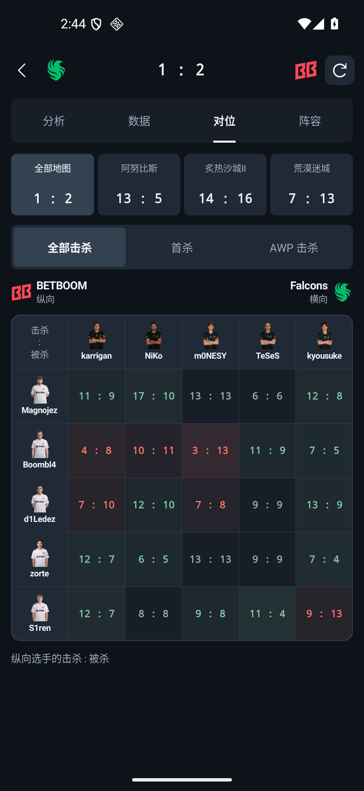
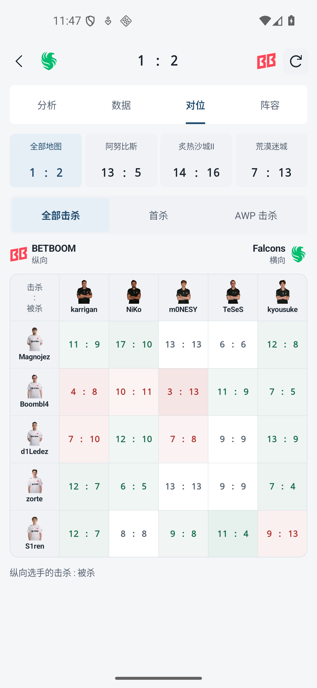
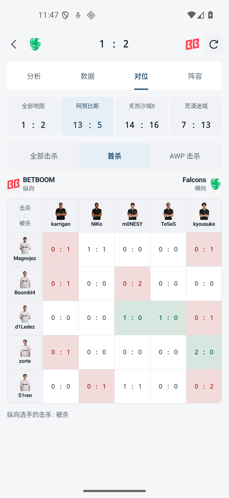

# RushB 0.10.7 验证记录

应用 ID `dev.matchscope.app`，versionCode 22。2026-10-25～26 在专用 RushB_ProfileReview / emulator-5554、Android 16 / API 36 / x86_64 完成比赛对位页面的构建与验证。前一版的浅色修订和独立 UI 审阅见 [0.10.6 修订记录](UI-REVIEW-v0106.md)。

## 本轮修改

- 比赛详情增加“对位”页，统计区也提供“对位数据”入口。统计和对位页面切换时保留对应地图；Both／T／CT 只控制选手统计，不会冒充对位的阵营筛选。
- 可切换全部地图、已提供对位数据的单图，以及全部击杀、首杀、AWP 击杀。没有系列汇总或选手统计时，已有单图矩阵仍可直接查看。
- 完整 5×5 矩阵保持在屏幕宽度内，显示头像、姓名、队标和纵横方向。数值统一字号、缺失为“—”、真实零值保留；颜色按纵向选手的击杀差区分。点击格子查看双向击杀，头像可进入选手档案。
- 修复 BO3 以 2:0 结束、第三图未打时无法生成系列对位的问题。汇总校验实际地图胜负、来源、双方选手 ID 和每个指标的完整格子集合；缺少一图／一个指标、替补导致双方集合不同或比赛尚在进行时，不冒充完整系列汇总。不同地图交换矩阵方向时按选手 ID 对齐。
- 修复对位短页面切换后露出被截断比赛卡片的问题；适配深浅主题、窄屏和大字体。
- 无数据页面保留重试及应用内 HLTV 验证入口；未开始比赛显示对应状态。

## 自动检查

| 检查 | 结果 |
| --- | --- |
| JVM 单元测试 | 171 通过，0 失败、错误或跳过 |
| Android 常规回归 | 108 通过，0 失败；129.966 秒 |
| Lint | 0 错误，20 项提示 |
| 构建 | ARM64、ARM 32 位、x86_64 与测试 APK 成功 |
| JS 离线检查 | 网页／JSON／RSS 读取检查及 3 项中继策略测试通过 |

本轮新增 6 项汇总与完整性单元测试、5 项 Compose 交互／布局测试，均包含在上述合计中。Android 覆盖无统计表时仍显示单图、完整 25 格、320dp／1.5 倍字体、两种主题、指标恢复、格子明细、数据页地图联动及空态恢复入口。第一轮 19 项专项通过后，针对数字缩放和顶部残片完成修订，再以最终 APK 运行常规回归。

Lint 提示为 11 项 UseKtx、4 项 GradleDependency、4 项 NewerVersionAvailable、1 项 OldTargetApi。曾发现并修正一处缩进错误；旧 Gradle 进程在 Lint 遍历中停滞，改用独立进程重跑后构建通过，没有屏蔽检查。首次完整回归的一项断言同时匹配两队表头，已限定到目标战队后重跑，最终 108 项全部通过。最终成功构建日志 `.local/duels-build-verified.log`，回归日志 `.local/duels-android-final.log`。

## 模拟器操作与真实来源

实际使用应用内正常读取的 Falcons–BETBOOM 比赛 `2399415`，未向正式应用注入测试夹具。该移动响应包含 Anubis、Dust2、Mirage，各自三个指标、每个指标 25 格；完整系列汇总同样为三个指标、各 25 格。

- 逐一打开全部击杀、首杀和 AWP，切换总计与单图。系列 AWP 中 Boombl4 对 m0NESY 为 **0 : 6**；点击明细显示两个方向的实际含义。
- 点击 m0NESY 头像进入档案后返回，对位指标保持。实际从 Anubis／CT 统计进入对位，再选择 Mirage 返回统计，地图联动正常；对位页面不显示 T／CT 控件。
- 顶部比较双方比分，矩阵不需要横向滑动。深色、浅色分别截图；短页面的顶部卡片不再残留一截。
- 最终 APK 在 2026-10-26 22:37:27（香港时间）由模拟器内的应用直接通过 HTTPS 读取该比赛，来源记录为 NETWORK、无 warning，中继关闭、ADB reverse 为空。该次读取证据与截图哈希见 [验证摘要](evidence/duels-v0107.json)。汇总测试另行确认生成总计不会更改原采集时间。

| 深色 | 浅色 | 单图首杀 |
| --- | --- | --- |
|  |  |  |

[AWP](screenshots/review-v0107/after/04-awp.png) · [双向明细](screenshots/review-v0107/after/05-duel-detail.png) · [头像进入档案](screenshots/review-v0107/after/06-player-navigation.png) · [统计进入对位](screenshots/review-v0107/after/07-data-to-duels.png) · [对位返回统计](screenshots/review-v0107/after/08-duels-to-data.png)。

[320dp／1.5 倍字体深色](screenshots/review-v0107/boundary/duels-dark-320dp.png) · [浅色](screenshots/review-v0107/boundary/duels-light-320dp.png)。这两张是 Compose 测试使用已记录数据生成的布局证据，不是新的联网读取截图。

本轮验证不包含真机、移动网络或长期联网稳定性。没有数据时不会从 K-D 推算对位；网站 HTML 对位解析仍需可靠样本，当前主要数据来自实际移动响应。来源未提供的指标不展示为已取得；单次网络成功不表示 403、完整性限制或图片访问在所有环境下均已解决。APK 仅保存在本机输出目录，源码仓库不包含安装包、会话、SDK 配置或原始用户缓存。
